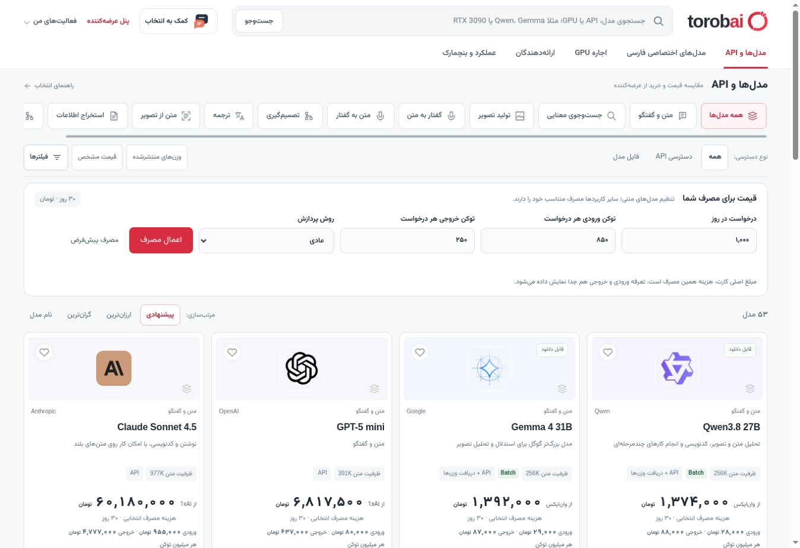
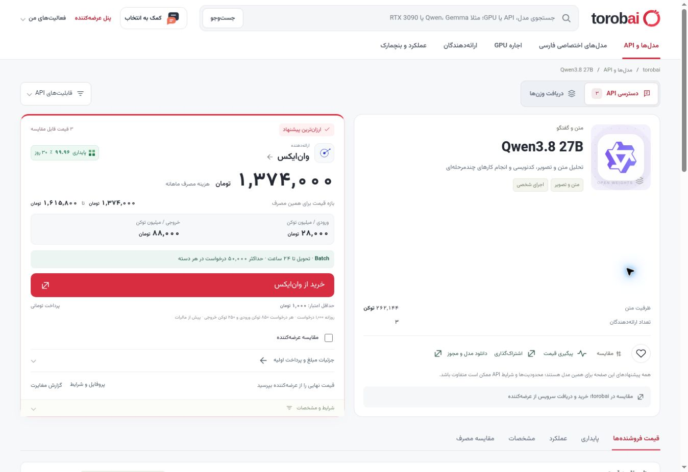
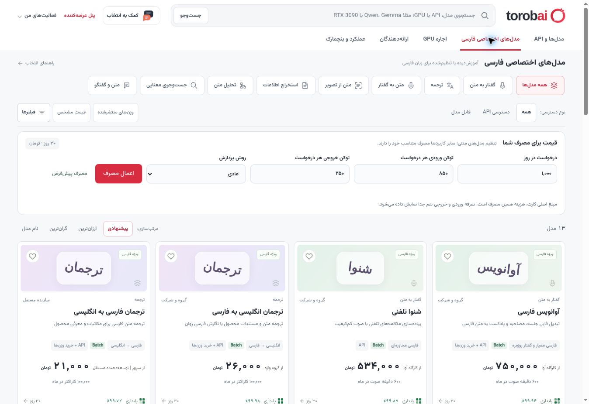
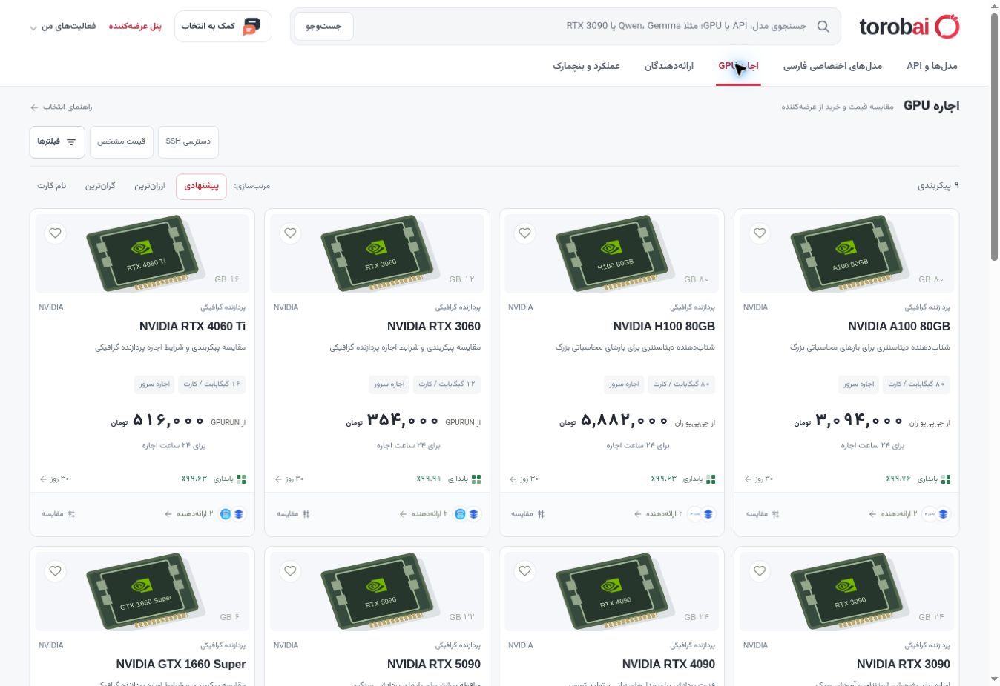
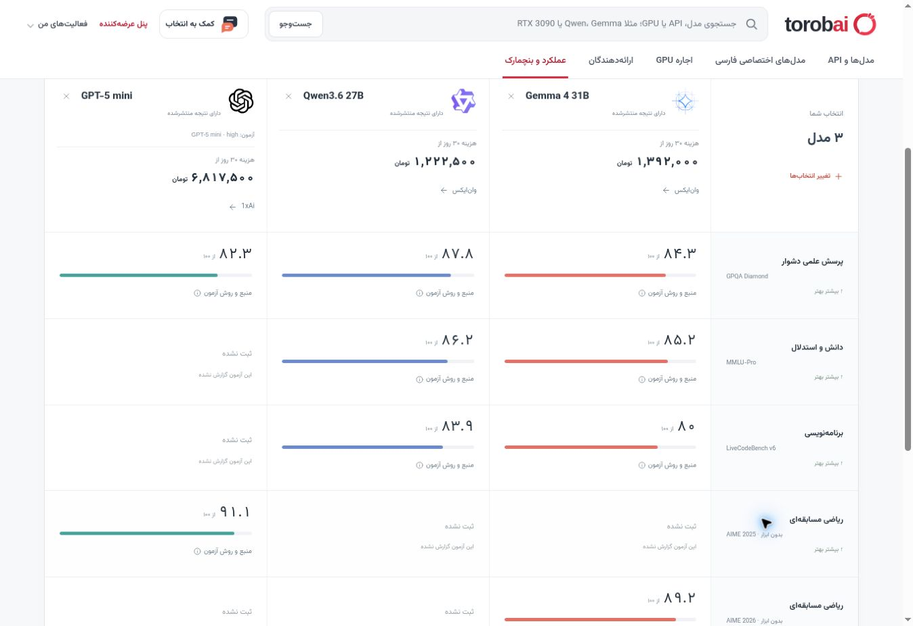
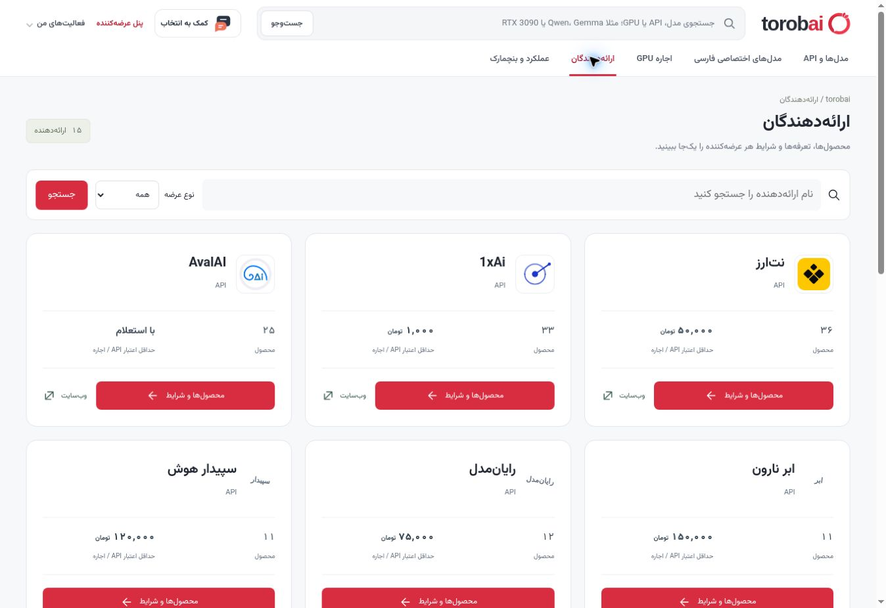
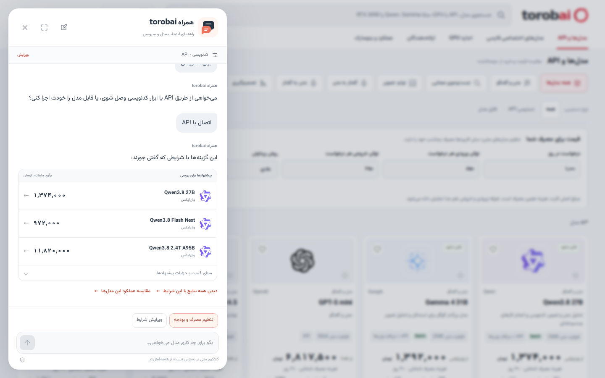
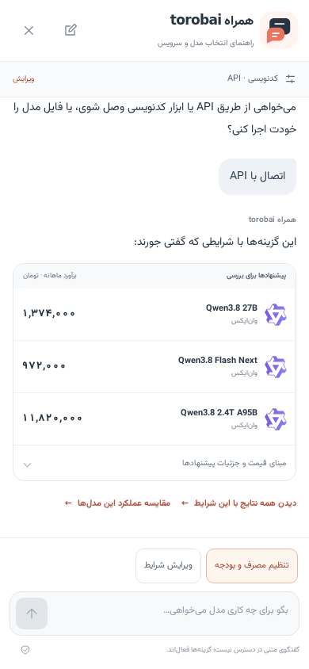

<h1 dir="ltr"> torobai</h1>

**مقایسه مدل‌های هوش مصنوعی، سرویس‌های API و اجاره GPU**

<a href="https://m0bin.github.io/torobai/#api">مشاهده سایت</a> · <a href="docs/GETTING_STARTED.md">راه‌اندازی پروژه</a> · <a href="chatbot/README.md">راهنمای چت‌بات</a>

در **torobai**، توسعه‌دهندگان و تیم‌ها می‌توانند مدل مناسب را پیدا کنند، هزینه استفاده را بسنجند و ارائه‌دهنده را انتخاب کنند. جستجو، قیمت‌های تومانی و مقایسه عملکرد در یک رابط فارسی کنار هم قرار گرفته‌اند؛ با بخشی مستقل برای مدل‌های تخصصی فارسی.

کاربر پیشنهادها را در torobai مقایسه می‌کند و برای خرید یا دریافت سرویس به عرضه‌کننده می‌رسد. هر مدل می‌تواند چند ارائه‌دهنده، دسترسی API و امکان دریافت وزن‌ها داشته باشد.

## محیط محصول

برای مشاهده اندازه کامل، روی تصویر کلیک کنید.

<table width="100%">
  <tr>
    <td align="center" width="33%">
       
      <strong>مدل‌ها و API</strong>
    </td>
    <td align="center" width="33%">
       
      <strong>صفحه مدل و قیمت‌ها</strong>
    </td>
    <td align="center" width="33%">
       
      <strong>مدل‌های اختصاصی فارسی</strong>
    </td>
  </tr>
  <tr>
    <td align="center" width="33%">
       
      <strong>اجاره GPU</strong>
    </td>
    <td align="center" width="33%">
       
      <strong>مقایسه عملکرد مدل‌ها</strong>
    </td>
    <td align="center" width="33%">
       
      <strong>ارائه‌دهندگان</strong>
    </td>
  </tr>
</table>

## امکانات اصلی

| بخش | کاربرد |
| ---: | ---: |
| **مدل‌ها و API** | جستجو بر اساس کاربرد، قابلیت و نوع دسترسی؛ مشاهده ارزان‌ترین پیشنهاد و بازه قیمت برای همان نسخه مدل. |
| **مقایسه هزینه** | محاسبه با مصرف دلخواه، تعرفه ورودی و خروجی و شرایط Batch؛ با واحد متناسب هر سرویس، از توکن تا دقیقه صوت. |
| **مدل‌های اختصاصی فارسی** | مدل‌های گفتار، ترجمه، پردازش اسناد و تحلیل متن؛ با امکان عرضه API، مجوز وزن‌ها یا هر دو. |
| **اجاره GPU** | مقایسه حافظه، هزینه و شرایط اجاره؛ همراه با ابزار برآورد حافظه مورد نیاز برای اجرای مدل. |
| **عملکرد و بنچمارک** | مقایسه گرافیکی تا چهار مدل، همراه با هزینه استفاده، منبع نتایج و شرایط آزمون. |
| **ارائه‌دهندگان و عرضه مدل** | بررسی خدمات هر ارائه‌دهنده و آماده‌سازی پیشنهادهای افراد و شرکت‌ها در پنل عرضه‌کننده. |

نشان‌شده‌ها، بازدیدهای اخیر، پیگیری قیمت و گزارش مغایرت، ادامه مسیر بررسی را آسان‌تر می‌کنند. این سوابق و پیش‌نویس‌های عرضه‌کننده در مرورگر کاربر ذخیره می‌شوند.

## چت‌بات راهنمای انتخاب

کاربر می‌تواند از نیازش شروع کند:

«برای کدنویسی یک مدل می‌خواهم که از طریق API استفاده کنم و هزینه‌اش با بودجه‌ام جور باشد.»

راهنما کاربرد، بودجه، میزان مصرف و قابلیت‌های لازم را مشخص می‌کند و فقط سوال‌هایی را می‌پرسد که برای انتخاب لازم‌اند. نتیجه، حداکثر سه پیشنهاد از کاتالوگ با هزینه برآوردی و لینک مدل یا نتایج فیلترشده است. کاربر می‌تواند شرایط را در همان گفتگو تغییر دهد و پیشنهادهای تازه بگیرد.

فهم متن آزاد با **OpenRouter** انجام می‌شود؛ انتخاب پیشنهادها، محاسبه قیمت و ساخت لینک‌ها بر عهده منطق خود برنامه است. به این ترتیب، گفتگو و صفحه مقصد از یک کاتالوگ و مبنای قیمت مشترک استفاده می‌کنند.

<table>
  <tr>
    <td align="center" valign="top">
       
      <strong>گفتگو و پیشنهادها</strong>
    </td>
    <td align="center" valign="top">
       
      <strong>نسخه موبایل</strong>
    </td>
    <td align="center" valign="top">
       
      <strong>مصرف و بودجه</strong>
    </td>
  </tr>
</table>

[راهنمای چت‌بات و اتصال به OpenRouter](chatbot/README.md)

## راه‌اندازی و توسعه

رابط کاربری با **HTML، CSS و JavaScript** و سرور با **FastAPI** ساخته شده است. کاتالوگ و محاسبات قیمت میان سایت و چت‌بات مشترک‌اند؛ کد چت‌بات هم در پوشه مستقل `chatbot/` قرار دارد.

| روش اجرا | امکانات |
| ---: | ---: |
| [**GitHub Pages و HTML مستقل**](docs/DEPLOYMENT.md#github-pages) | کاتالوگ، مقایسه‌ها و انتخاب‌های آماده چت‌بات؛ با فونت‌ها و داده‌های داخل فایل. |
| [**سرور Python**](docs/GETTING_STARTED.md#run-locally) | امکانات سایت به همراه گفتگوی آزاد، با تنظیم کلید OpenRouter روی سرور. |

پس از هر تغییر در شاخه `main`، GitHub Actions آزمون‌ها را اجرا می‌کند و در صورت موفقیت، HTML جدید را روی Pages منتشر می‌کند.

<strong>ساختار کد</strong>

| مسیر | مسئولیت |
| ---: | ---: |
| [app/main.py](app/main.py) | سرور و مسیرهای API |
| [app/market.py](app/market.py) و [app/pricing_plan.py](app/pricing_plan.py) | جستجو، فیلترها و محاسبه تعرفه‌ها |
| [app/data/](app/data/) | مدل‌ها، پیشنهادها، ارائه‌دهندگان و داده‌های بنچمارک |
| [app/static/](app/static/) | صفحات و تعاملات رابط کاربری |
| [chatbot/](chatbot/) | منطق گفتگو، رابط چت و اتصال به OpenRouter |
| [scripts/export_catalog.py](scripts/export_catalog.py) | ساخت فایل HTML مستقل |
| [tests/](tests/) و [chatbot/tests/](chatbot/tests/) | آزمون‌های سایت و چت‌بات |

[راهنمای توسعه](AGENTS.md) · [منابع بنچمارک](docs/BENCHMARK_COVERAGE.md) · [تاریخچه تغییرات](docs/CHANGELOG.md)

